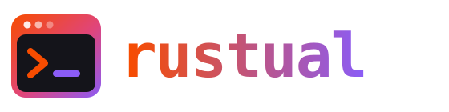
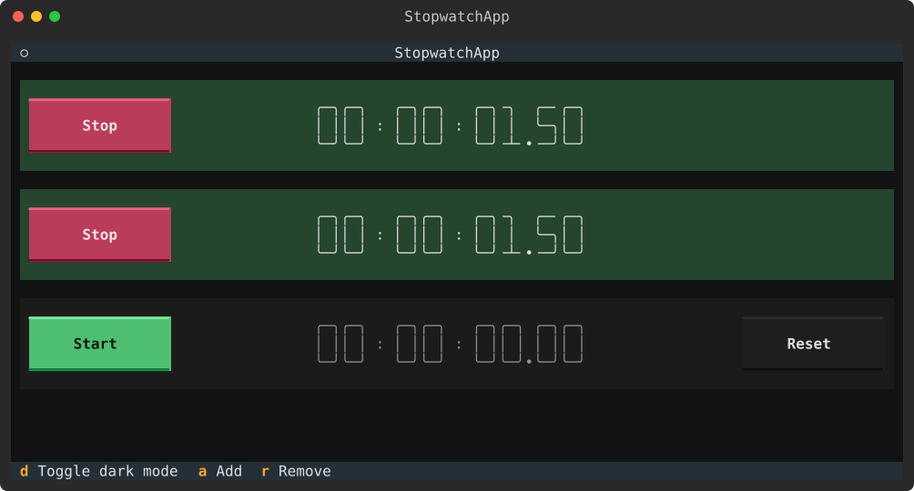
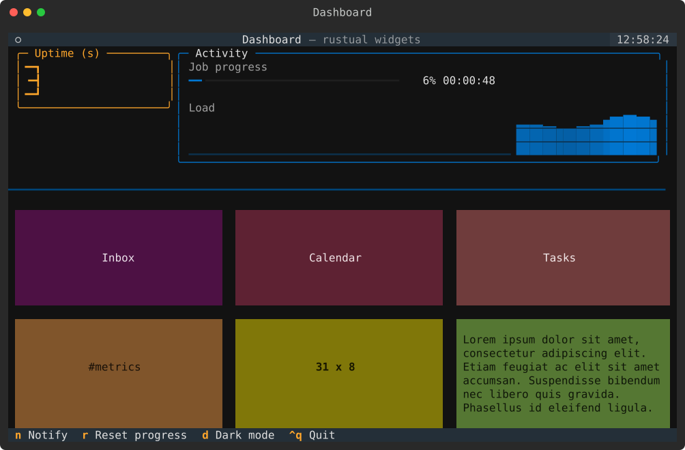
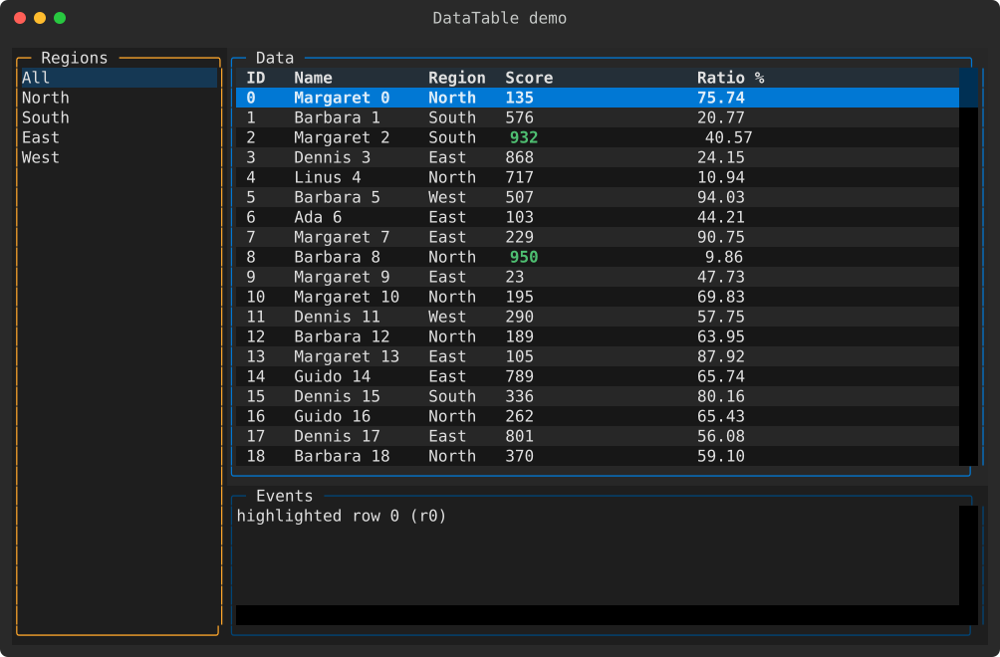
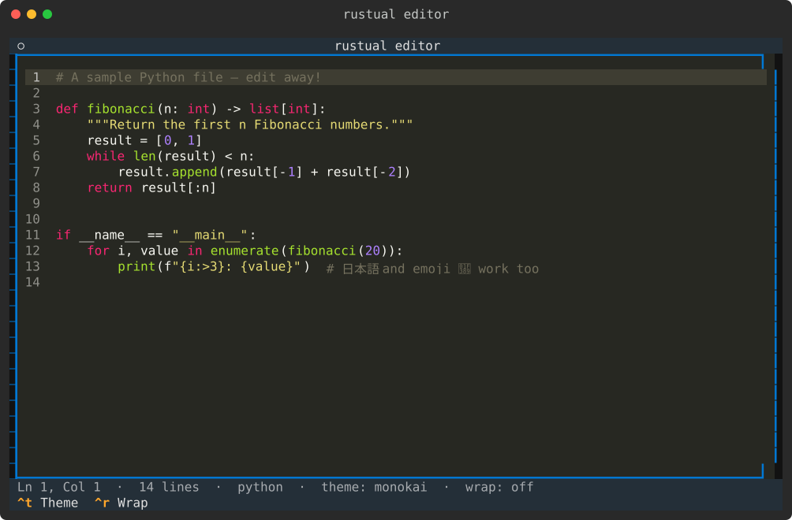
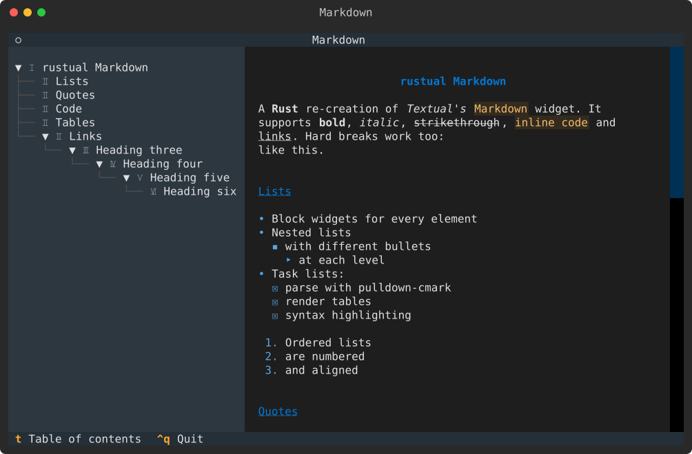
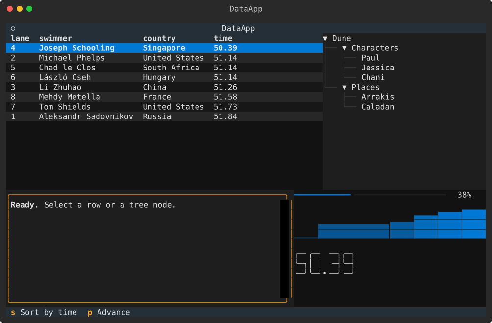
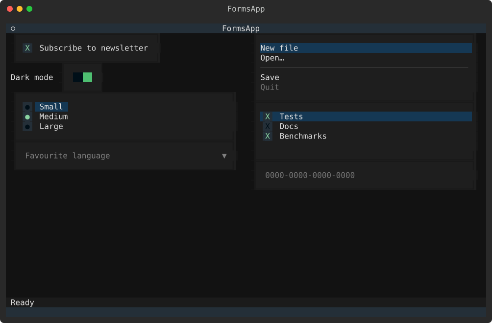
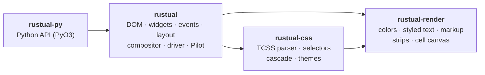

<a id="readme-top"></a>

<div align="center">



### Textual's TUI framework, rebuilt in Rust.<br>Use it from Rust, or from Python with the same API, much faster.

<br>

[](https://github.com/Awareness10/rustual/actions/workflows/ci.yml)
[](#testing)
[](#testing)
[](#testing)
<br>
[](https://github.com/Awareness10/rustual/releases/latest)
[](LICENSE)
[](https://www.rust-lang.org)
[](crates/rustual-py)
[](features.md)

**[Quick start](#quick-start)** ·
**[Python](#python)** ·
**[Gallery](#gallery)** ·
**[Benchmarks](#benchmarks)** ·
**[Architecture](#architecture)** ·
**[Roadmap](ToDo.md)**

<br>



<sub>Textual's stopwatch tutorial in Python, unchanged except for its imports, running on rustual.<br>
Every screenshot in this README was rendered by rustual itself.</sub>

</div>

<br>

## Why rustual?

[Textual](https://textual.textualize.io) is a wonderful way to build terminal apps: a DOM of
widgets, styled with CSS, laid out like the web. **rustual** re-creates it in Rust (same
concepts, same CSS, same widgets) and brings it back to Python through a binding with
Textual's own API.

<table>
<tr>
<td width="33%" valign="top">

**⚡ Fast**<br>
Layout, styling and rendering run in Rust. Python apps start ~56× faster and react ~24× faster than on Textual.

</td>
<td width="33%" valign="top">

**🎨 Textual CSS**<br>
TCSS with variables, nesting, themes, transitions, and vertical / horizontal / grid / dock layouts with layers.

</td>
<td width="33%" valign="top">

**🧩 40+ widgets**<br>
DataTable, Tree, TextArea, Markdown, TabbedContent, Select, Input and more, ported from Textual.

</td>
</tr>
<tr>
<td valign="top">

**🐍 Python API**<br>
`from rustual.app import App`: reactive attributes, `@on`, screens, workers and async, as in Textual.

</td>
<td valign="top">

**🧪 Headless testing**<br>
Drive apps with a `Pilot` (keys, clicks, hover, resize) from `cargo test` or `pytest`.

</td>
<td valign="top">

**🖼️ SVG screenshots**<br>
Render any app to SVG without a terminal: one environment variable, handy for docs and CI.

</td>
</tr>
</table>

## Quick start

rustual is on [crates.io](https://crates.io/crates/rustual) and [PyPI](https://pypi.org/project/rustual-py/)
(prebuilt wheels for Linux, Windows and macOS; also attached to the
[GitHub releases](https://github.com/Awareness10/rustual/releases)).

<details open>
<summary><b>Rust</b></summary>

```toml
# cargo add rustual tokio --features tokio/full
[dependencies]
rustual = "0.2"
tokio = { version = "1", features = ["full"] }
```

```rust
use rustual::prelude::*;

struct Hello;

impl Widget for Hello {
    fn compose(&mut self) -> Vec<Child> {
        compose![
            Label::new("Hello, [b $accent]World[/]!").id("greeting"),
            Button::primary("Quit").id("quit"),
        ]
    }

    fn on_message(&mut self, msg: &Message, ctx: &mut Ctx) -> Flow {
        if msg.get::<button::Pressed>().is_some() && msg.sender_id() == Some("quit") {
            ctx.exit();
        }
        Flow::Continue
    }
}

#[tokio::main]
async fn main() -> std::io::Result<()> {
    App::new(Hello)
        .css("Screen { align: center middle; } #greeting { margin: 1; }")
        .run()
        .await
}
```

Or try the bundled examples: `cargo run -p rustual --example dashboard`
(also `hello`, `form`, `table`, `navigator`, `editor`, `markdown`, `palette`, `modes`,
`widgets_extra`). `ctrl+p` opens the command palette, `ctrl+q` quits.

</details>

<details open>
<summary><b>Python</b></summary>

```sh
uvx rustual-py                # try it: a launcher for the bundled examples, nothing to install
pip install rustual-py        # or: uv add rustual-py   (CPython 3.10+)
```

Or build from source (needs Rust):

```sh
git clone https://github.com/Awareness10/rustual && cd rustual/crates/rustual-py
uv sync                               # builds the Rust extension with maturin
uv run rustual-py stopwatch
```

```python
from rustual import on
from rustual.app import App, ComposeResult
from rustual.reactive import reactive
from rustual.widgets import Button, Footer, Header, Static


class Counter(Static):
    count = reactive(0)

    def render(self) -> str:
        return f"Count: [b]{self.count}[/b]"


class CounterApp(App):
    CSS = "Counter { height: 3; border: round $accent; }"
    BINDINGS = [("+", "increment", "Add one")]

    def compose(self) -> ComposeResult:
        yield Header()
        yield Counter()
        yield Button("Add", id="add", variant="primary")
        yield Footer()

    def action_increment(self) -> None:
        self.query_one(Counter).count += 1

    @on(Button.Pressed, "#add")
    def add(self) -> None:
        self.action_increment()


if __name__ == "__main__":
    CounterApp().run()
```

</details>

<p align="right"><a href="#readme-top">back to top ↑</a></p>

## Python

`rustual-py` is a [PyO3](https://pyo3.rs) extension with a **Textual-compatible API**. Porting an
app is usually a matter of changing its imports:

```diff
-from textual.app import App, ComposeResult
-from textual.widgets import Button, DataTable, Footer
+from rustual.app import App, ComposeResult
+from rustual.widgets import Button, DataTable, Footer
```

- **Same model:** `compose()` with `with` blocks, `DEFAULT_CSS` / `CSS` / `CSS_PATH`, `BINDINGS`
  and `action_*`, `reactive` with `watch_` / `validate_` / `compute_`, messages with `@on`
  selectors, screens and `ModalScreen`, `run_test()` + `Pilot`.
- **Async and threads, done safely:** async handlers and `@work` workers run on an asyncio loop
  on the app thread; thread workers can call widget methods directly (calls are marshalled to the
  app thread). The event loop runs with the GIL released, and nothing waits on another thread
  while holding it.
- **Rich renderables:** `Table`, `Syntax`, `Panel` and friends render in `Static` and `render()`.

Details: [`crates/rustual-py`](crates/rustual-py/README.md) ·
[design notes](docs/python-bindings.md).

## Gallery

<table>
<tr>
<td width="50%"><br><sub><b>Dashboard</b>: grid, sparkline, progress, digits · <a href="crates/rustual/examples/dashboard.rs">Rust</a></sub></td>
<td width="50%"><br><sub><b>DataTable</b>: sorting, cursors, filtering · <a href="crates/rustual/examples/table.rs">Rust</a></sub></td>
</tr>
<tr>
<td><br><sub><b>Editor</b>: TextArea with highlighting and themes · <a href="crates/rustual/examples/editor.rs">Rust</a></sub></td>
<td><br><sub><b>Markdown</b>: viewer with table of contents · <a href="crates/rustual/examples/markdown.rs">Rust</a></sub></td>
</tr>
<tr>
<td><br><sub><b>Data widgets</b>: DataTable, Tree, RichLog · <a href="crates/rustual-py/python/rustual/demo/data.py">Python</a></sub></td>
<td><br><sub><b>Forms</b>: Checkbox, Switch, RadioSet, Select, OptionList · <a href="crates/rustual-py/python/rustual/demo/forms.py">Python</a></sub></td>
</tr>
</table>

Make your own: `TEXTUAL_SCREENSHOT=shot.svg TEXTUAL_SIZE=100x30 TEXTUAL_PRESS=tab,down cargo run -p rustual --example table`
(works for Python apps too).

## Benchmarks

The same Python app code, run headlessly with `run_test()` against
[Textual 8.2.8](https://github.com/Textualize/textual) (release build, median of 3 runs, Python 3.14):

| Scenario | Textual | rustual | Speed-up |
|---|---:|---:|---:|
| Startup with 1000 rows (3000 widgets) | 1951 ms | 35 ms | **~56×** |
| 100 key presses updating a reactive | 5191 ms | 220 ms | **~24×** |
| 100 scroll steps over 1000 rows | 11456 ms | 853 ms | **~13×** |

Every rustual step includes rendering a full frame. Reproduce with
[`bench/bench.py`](crates/rustual-py/bench/bench.py). The Rust core renders a frame with 1000 widgets
in about 2 ms.

<p align="right"><a href="#readme-top">back to top ↑</a></p>

## What's included

<details>
<summary><b>Widgets</b> (40+)</summary>
<br>

| Category | Widgets |
|---|---|
| Text & display | Static, Label, Markdown, MarkdownViewer, Pretty, Digits, Rule, Placeholder, Link, Welcome |
| Input | Button, Input, MaskedInput, TextArea, Checkbox, Switch, RadioButton, RadioSet, Select, SelectionList |
| Data | DataTable, Tree, DirectoryTree, ListView, OptionList, Log, RichLog, Sparkline, ProgressBar, LoadingIndicator |
| Navigation | Tabs, TabbedContent, ContentSwitcher, Collapsible, Header, Footer, KeyPanel, HelpPanel |
| Overlays | Tooltip, Toasts (notifications), command palette |
| Containers | Container, Vertical, Horizontal, Grid, Center, Middle, Right, VerticalScroll, HorizontalScroll, ... |

</details>

<details>
<summary><b>Core features</b></summary>
<br>

- Textual CSS: variables, nesting, `!important`, pseudo-classes, themes and the design system
- Layouts: vertical, horizontal, grid, dock, layers, offsets, scrolling with scrollbars
- Screens, modal screens, modes, maximize, loading overlays
- Bindings with keymaps, `check_action`, actions with namespaces and arguments
- Animations with Textual's easing functions, CSS transitions, timers
- Async workers, notifications, clipboard (OSC 52), suspend, SVG screenshots
- Command palette, tooltips, help panel

Per-feature parity with Textual is tracked in [`features.md`](features.md).

</details>

<details>
<summary><b>Textual concepts in Rust</b></summary>
<br>

| Textual (Python) | rustual (Rust) |
|---|---|
| `class MyApp(App)` with `compose`, `BINDINGS`, `action_*`, `on_*` | `impl Widget for MyApp` passed to `App::new` |
| `yield Button("OK", id="ok")` | `compose![Button::new("OK").id("ok")]` |
| `with Horizontal(): ...` | `Horizontal::new().with(compose![...])` |
| `DEFAULT_CSS`, `CSS`, `CSS_PATH` | `Widget::default_css`, `App::css`, `App::css_path` |
| `on_button_pressed(self, event)` | `on_message`: `msg.get::<button::Pressed>()` |
| `self.query_one("#x", Label)` | `ctx.query_one::<Label>("#x")` |
| `@work async def` | `ctx.run_worker(async { Msg })` |
| `set_interval` | `ctx.set_interval(dur, \|w: &mut Self, ctx\| ..)` |
| `push_screen` / `dismiss` | `ctx.push_screen` / `ctx.push_modal` / `ctx.dismiss(result)` |
| `async with app.run_test() as pilot` | `let mut pilot = App::new(..).test(size).await` |

</details>

## Architecture



| Crate | Role |
|---|---|
| [`rustual-render`](crates/rustual-render) | Geometry, colors, styles, cell widths, styled text and markup, strips, border glyphs, a cell canvas with diffing (the Rich layer) |
| [`rustual-css`](crates/rustual-css) | TCSS tokenizer and parser (variables, nesting, `!important`), selectors and specificity, typed `Styles`, cascade, themes |
| [`rustual`](crates/rustual) | DOM, widgets, events / messages / bindings / actions, layout, compositor, crossterm driver, async runtime (tokio), Pilot |
| [`rustual-py`](crates/rustual-py) | Python bindings built with maturin and uv: the `rustual` package |

More in the [design doc](docs/plans/2026-10-14-rustual-design.md),
the [widget guide](docs/widget-guide.md) and the [Python binding notes](docs/python-bindings.md).

<p align="right"><a href="#readme-top">back to top ↑</a></p>

## Testing

Apps are tested headlessly with a `Pilot`, in either language:

<table>
<tr>
<td width="50%" valign="top">

```rust
#[tokio::test]
async fn quit_button_exits() {
    let mut pilot = App::new(Hello)
        .test(Size::new(80, 24))
        .await;
    pilot.click("#quit").await;
    assert!(pilot.has_exited());
}
```

</td>
<td width="50%" valign="top">

```python
async def test_counter():
    app = CounterApp()
    async with app.run_test() as pilot:
        await pilot.press("+")
        assert app.query_one(Counter).count == 1
        assert "Count: 1" in pilot.screen_text()
```

</td>
</tr>
</table>

```sh
cargo test                                      # Rust tests
cd crates/rustual-py && uv run pytest           # Python tests
cargo llvm-cov --workspace --exclude rustual-py # Rust line coverage
uv run pytest --cov=rustual                     # Python line coverage
```

Latest results on `main`, published by CI on every push:

[](https://github.com/Awareness10/rustual/actions/workflows/ci.yml)
[](https://github.com/Awareness10/rustual/actions/workflows/ci.yml)
[](https://github.com/Awareness10/rustual/actions/workflows/ci.yml)
[](https://github.com/Awareness10/rustual/actions/workflows/ci.yml)

<sub>The CI job runs the commands above and writes the results to the
[`badges`](https://github.com/Awareness10/rustual/tree/badges) branch
([`scripts/ci_badges.py`](scripts/ci_badges.py)); the badges read them from there.</sub>

## Status

rustual covers roughly 90% of the Textual features apps commonly use (about 70% of full parity);
[`features.md`](features.md) tracks every feature and [`ToDo.md`](ToDo.md) is the roadmap.
It's young: CI runs the test suite on Linux, macOS and Windows, but interactive use in real terminals
(especially on Windows) has had little testing so far.

## Contributing

Issues and pull requests are welcome; work happens on the `dev` branch (`main` holds releases, see
[`RELEASING.md`](RELEASING.md)). Before opening a PR:

```sh
cargo fmt --all && cargo clippy --workspace --all-targets -- -D warnings && cargo test
cd crates/rustual-py && uv sync --reinstall-package rustual-py && uv run pytest
```

New widgets follow the [widget guide](docs/widget-guide.md); Python bindings for them follow
[docs/python-bindings.md](docs/python-bindings.md#adding-a-widget-binding).

## License

MIT, like Textual. See [`LICENSE`](LICENSE).

## Acknowledgements

rustual is a re-creation of [Textual](https://github.com/Textualize/textual) and
[Rich](https://github.com/Textualize/rich) by Will McGugan and the Textualize team; their design,
CSS and behaviour are the reference for everything here. If you write Python TUIs, use and
support the originals.

<p align="right"><a href="#readme-top">back to top ↑</a></p>
